<p align="center">
  <a href="https://furkiozknn.github.io/cini-ustasi/">
    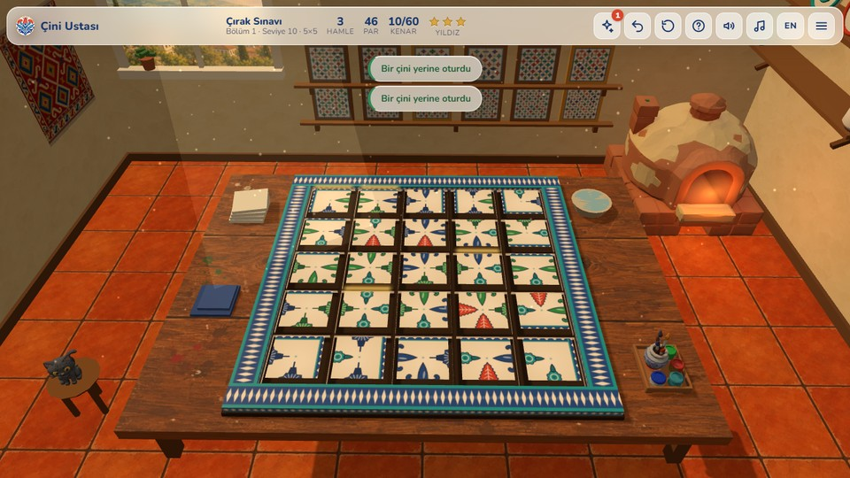
  </a>
</p>

<p align="center">
  <a href="https://furkiozknn.github.io/cini-ustasi/"></a>
</p>

<p align="center">
  
  
  <a href="LICENSE"></a>
  
</p>

<!-- portals:start -->
<p align="center">
  Also on: <a href="https://furkiozknn.itch.io/cini-ustasi"><strong>itch.io</strong></a> &middot; <a href="https://playgama.ai/play/3w2c2uyo35qj3q"><strong>Playgama</strong></a>
</p>
<!-- portals:end -->

<p align="center">
  <strong>A calm 3D edge-matching puzzle in a warm tile workshop: rotate, swap and flip hand-painted Iznik tiles until every tulip, carnation, saz leaf and rumi scroll connects, then fire the finished panel in the kiln and hang it on your wall.</strong>
</p>

<!-- gameplay gif -->

## Features

- **30 levels across 3 chapters:** Chapter 1 introduces tile rotation, Chapter 2 adds tile swapping, and Chapter 3 introduces fixed tiles and double-sided tiles you can flip, with boards scaling from 3x3 to 6x6.
- **Par scoring, stars & daily boards:** 1 to 3 stars per level based on par, with undo, restart, 3 hints per level that each fix one tile, a live star meter, and fresh 4x4 daily boards unlocked after Chapter 1 (including excavation boards with 3 weathered tiles on odd days).
- **Kiln firing & master glaze:** Solved panels glaze with a shine sweep and slide into the glowing kiln where a heat gauge rises; press Fire inside the glaze band to melt the frit into a glossy finish or dead centre for a master glaze, preserved across all 30 panels in the collection.
- **Living workshop atmosphere:** Hand-painted Iznik motifs (tulip, carnation, saz leaf, rumi scroll) in cobalt, turquoise, coral, and emerald, accompanied by kiln embers, dust motes in window light over Lake Iznik, an animated cat on a stool, and authentic Hicaz oud plucks synthesized via Web Audio.
- **Ultra-lean web performance:** A single `index.html` running Three.js r170 delivering a locked 60 fps at 21–58 draw calls on Intel UHD 620 (21 &rarr; 32 on title, 46 &rarr; 58 on level 10, 37 &rarr; 49 on level 22), with 358/358 unit tests passing and an automated `?auto` bot that clears all 30 levels with 0 JS errors.

## How to play

> [!TIP]
> **Goal:** Connect every edge on the board: each motif must meet its twin on the neighbouring tile. Solve the level in as few moves as possible to earn 3 stars, then fire the panel in the kiln at the right heat for a glossy finish.

1. **Rotate tiles (Click / tap):** Click a tile to rotate it by 90 degrees until the motifs connect. Matched edges glow gold.
2. **Swap and flip (Chapters 2 & 3):** Drag a tile onto another to swap their positions (from Chapter 2). In Chapter 3, double-sided tiles can be flipped with right-click, long press, or `F`.
3. **Fire the kiln:** When the board is solved, press **Fire** (or tap the card, `Enter`, `Space`) while the heat needle is in the glaze band to set the panel's finish (matte, glossy, or master glaze).

<details>
<summary><b>Rules and scoring</b></summary>

- **Par & stars:** Each level has a par, the length of the planned solution. Finishing at or under par gives 3 stars, within `ceil(1.6 x par) + 2` moves gives 2 stars, and any solve earns at least 1 star.
- **Hints:** Every level starts with three hints. A hint fixes one tile, planned against the board's own generated solution, so it is instant and never fails; undoing a hint gives it back.
- **Fixed & double-sided tiles:** Fixed tiles stay at their home position and cannot be rotated, swapped or flipped. Double-sided tiles have two active faces.
- **Kiln ratings:** The kiln step rates the finish: matte, glossy (needle in the band), or master glaze (needle in the narrow core). A panel keeps its best finish; skipping the step or letting the needle run to the end gives matte.
- **Daily & excavation boards:** The daily board is a fresh 4x4 puzzle seeded by the date, with rotations and swaps; it unlocks after chapter 1. On odd days it is an excavation board with three weathered tiles; the solution, hints and par are the same as the plain board for that date.
- **Master's gallery:** Solved panels join the collection and the gallery wall of the workshop (the wall shows the 12 latest, the collection keeps all 30); your best stars and finish per level are kept. Unlock four craft notes about Iznik tile, one per chapter.

</details>

### Controls

| Action | Mouse / touch | Keyboard |
|---|---|---|
| Rotate a tile 90 degrees | Click / tap | |
| Swap two tiles (chapter 2 on) | Drag one onto the other | |
| Flip a double-sided tile (chapter 3) | Right-click / long press | `F` on the hovered tile |
| Tilt the camera / zoom | Drag on the table / wheel or pinch | |
| Fire the kiln (after a solve) | Fire button or tap the card; Skip | `Enter` / `Space` / `F` |
| Undo / hint / restart | Top bar buttons | `Z` / `H` / `R` |
| Pause menu | Menu button | `P` / `Esc` |
| Music / effects / language | Pause menu, settings | `M` / `X` / `L` |
| Buttons | Tap | `Tab`, `Enter` / `Space` |

- **Global hotkeys:** `P` / `Esc` pause, `M` music, `X` effects, `L` language, `Z` undo, `H` hint, `R` restart.
- **Audio control:** Sound effects and music volumes are adjustable in settings or the pause menu, synthesised entirely with Web Audio API.
- **Touch:** Full touch support with tap to rotate, drag-and-drop to swap, long press to flip, pinch to zoom, and dedicated mobile HUD layouts.
- **Persistence:** Settings (master, music and effects volume, TR / EN, Low / High graphics, fullscreen) are saved in `localStorage` under `arena.cini.settings`; stars, unlocked levels and the collection under `arena.cini.save`, with **Continue** on the title screen. The first visit follows browser language and picks Low graphics on touch devices or CPUs with 4 threads or fewer.

<details>
<summary><b>URL flags for testing</b></summary>

| Flag | Effect |
|---|---|
| `?auto` | The game solves each board itself (plans to the generated solution) and moves on |
| `?debug` | Draw calls, fps and JS errors on screen; `window.ciniSim(seconds)` fast-forwards the game |
| `?sim=N` | Fast-forward N seconds before the first frame |
| `?level=N` / `?level=daily` | Jump to a level or the daily board |
| `?daykey=YYYY-MM-DD` | Force the daily board's date (an odd day gives the excavation board) |
| `?screen=levels` | Open a screen: `levels`, `collection`, `howto` (`&ch=N` picks the page), `settings` or `pause` |
| `?low` | Low graphics for this visit (not saved) |
| `?noassets` | Skip the asset files and use the procedural models and textures |
| `?lang=en` / `?lang=tr` | Language |
| `?fresh` | Start with empty progress and default settings |
| `?fill` | Fill the collection for screenshots (saving disabled) |
| `?noanim` / `?nohowto` / `?nokiln` | Skip CSS animations / skip the coach tips / skip the kiln firing step |

The live state is on `window.cini` (with a small test API on `window.cini.api`: `performMove`, `plan`, `lockKiln`, `mem`, `calls`, `tileScreenPos`).

</details>

## Screenshots

<table>
  <tr>
    <td width="33%">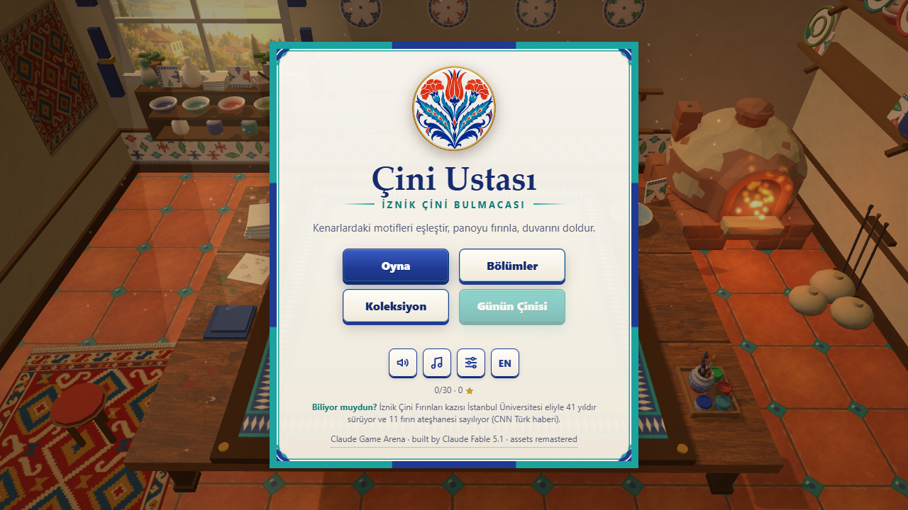<br><sub>Title screen</sub></td>
    <td width="33%">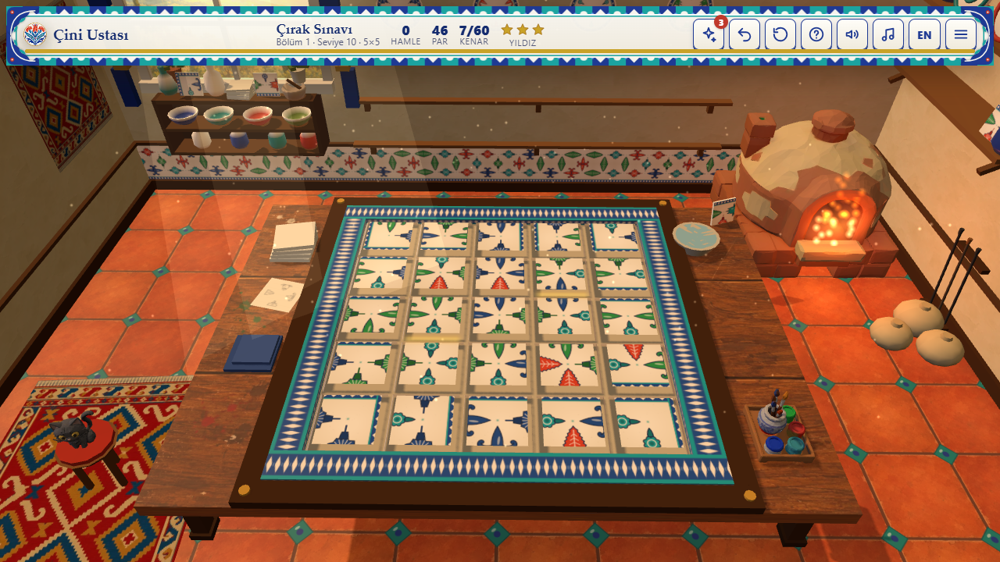<br><sub>Level 10, a 5x5 board mid-solve</sub></td>
    <td width="33%">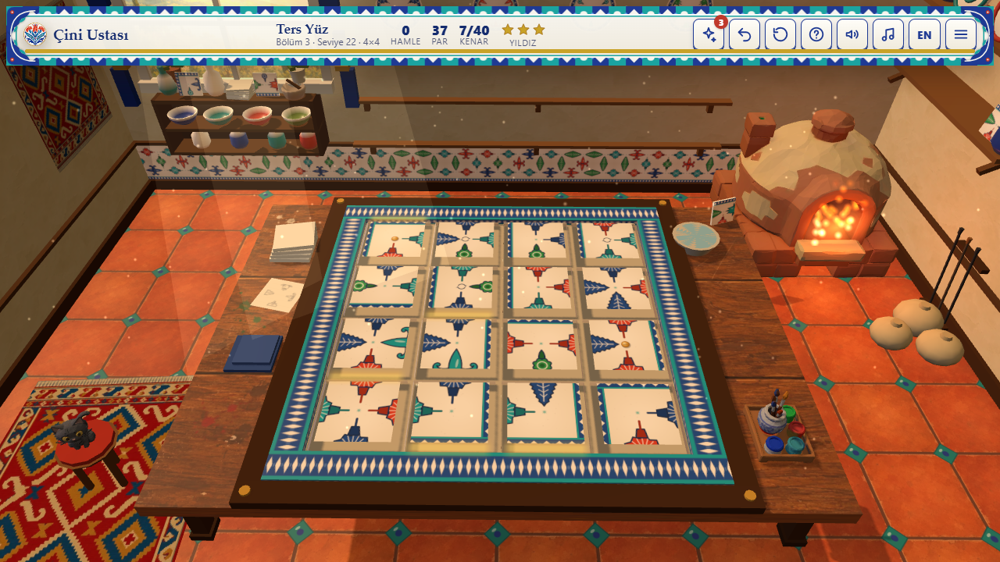<br><sub>Chapter 3: fixed and double-sided tiles</sub></td>
  </tr>
  <tr>
    <td>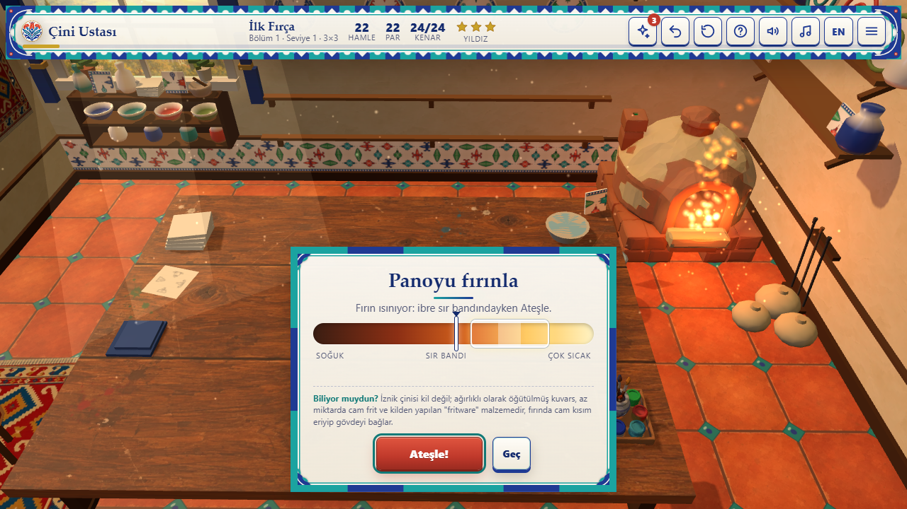<br><sub>The kiln step: fire inside the glaze band</sub></td>
    <td>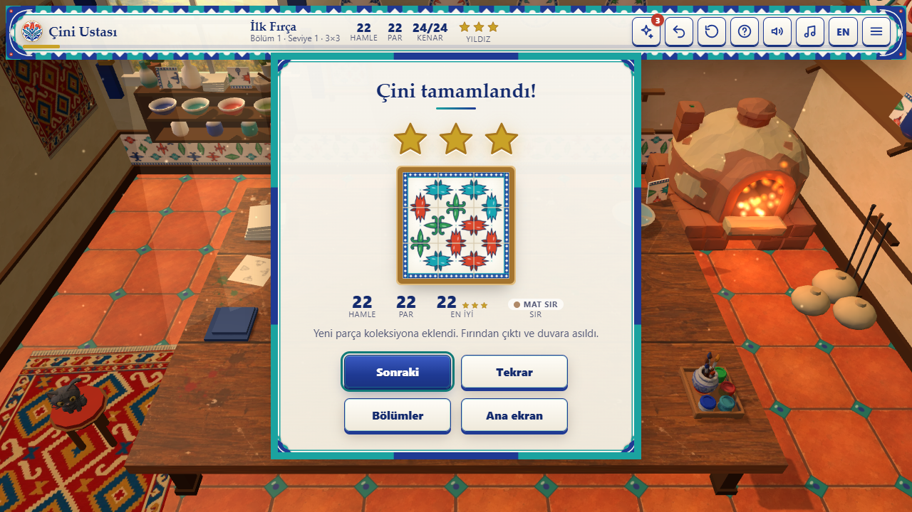<br><sub>Level complete, three stars, master glaze</sub></td>
    <td>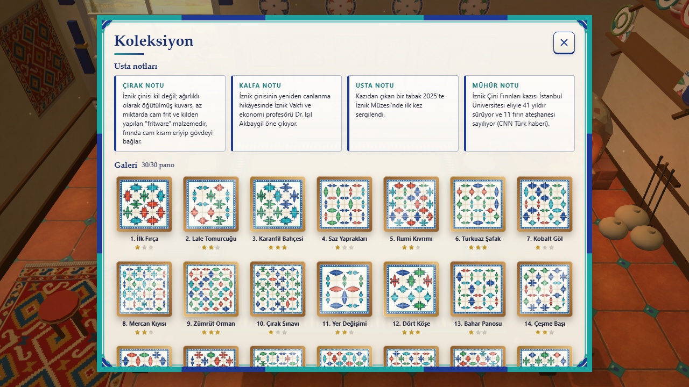<br><sub>The master's gallery</sub></td>
  </tr>
</table>

<details>
<summary><b>Coaching, excavation board, pause, settings and phone layout</b></summary>

<table>
  <tr>
    <td width="50%">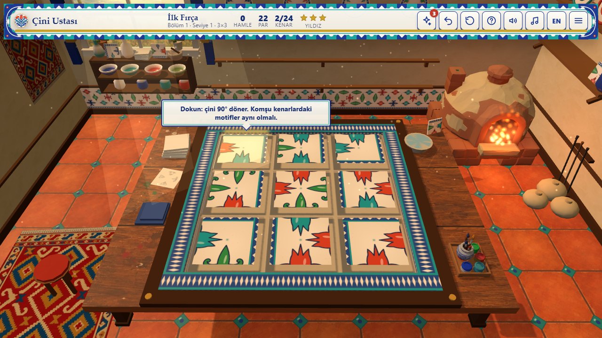<br><sub>Level 1: the tip points at the first wrong tile</sub></td>
    <td width="50%">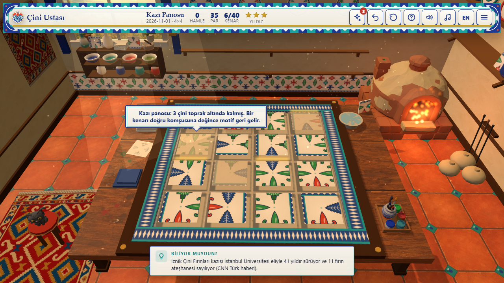<br><sub>Excavation board: three weathered tiles</sub></td>
  </tr>
  <tr>
    <td>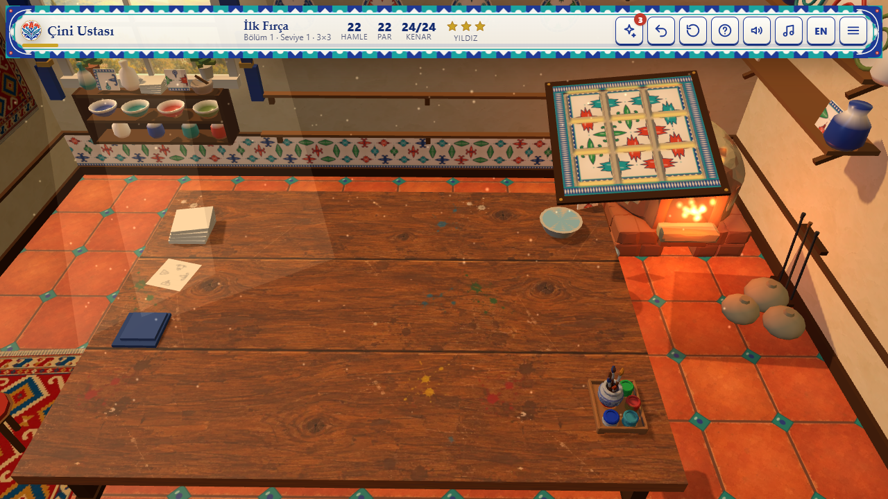<br><sub>The panel slides into the kiln</sub></td>
    <td>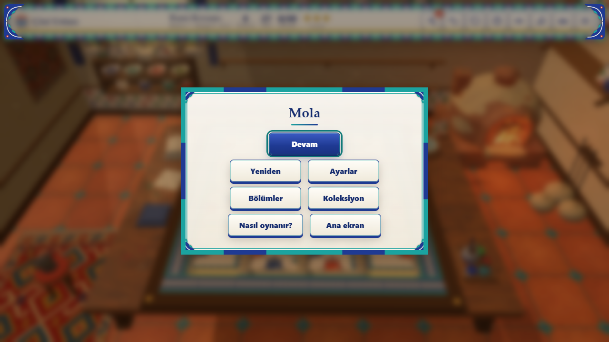<br><sub>Pause menu</sub></td>
  </tr>
  <tr>
    <td>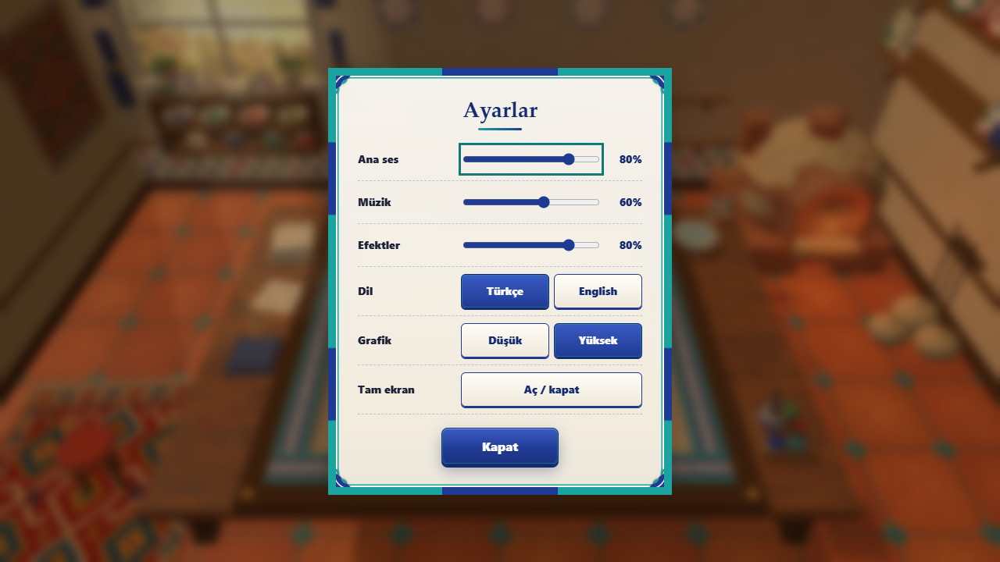<br><sub>Settings</sub></td>
    <td>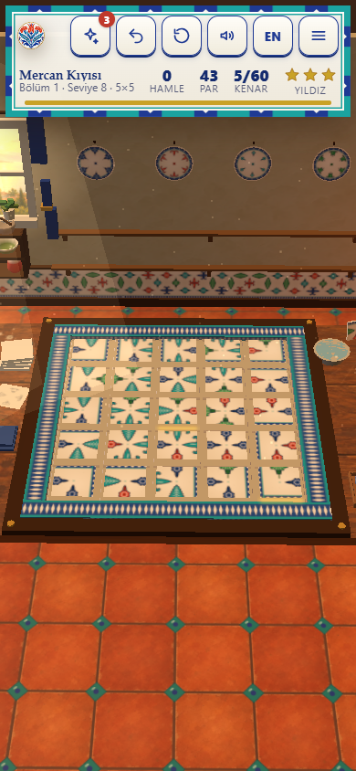<br><sub>Phone, level 8</sub></td>
  </tr>
  <tr>
    <td>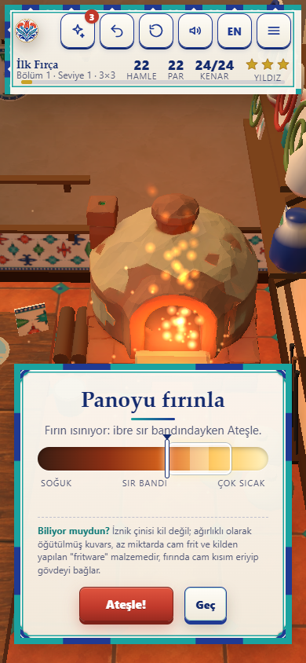<br><sub>Phone, the kiln step</sub></td>
    <td></td>
  </tr>
</table>

</details>

## Redesign & Performance

**Art direction:** An authentic İznik palette (cobalt `#1F3A93`, turquoise `#1BA3A0`, coral `#C0392B`, sage `#6E8B3D`, glaze white `#F7F4EC`) in a warm, lamp-lit workshop, with every panel framed like a ceramic tile.

**Visual updates (rules, controls, bot, and saves are untouched):**
- **Lighting:** A warm key light with a lamp glow over the table and a cooler fill from the window; the kiln mouth lights its surroundings and sheds a plume of ember particles.
- **Environment:** Glazed terracotta floor with turquoise inserts, a tile dado along the walls, a paint cabinet with glaze bowls, plates and a pitcher on the shelves, brick kiln base with firing tools, and the cat resting on its stool.
- **UI:** Tile-bordered panels with rumi spandrels in the corners (SVG) for title, pause, settings, how-to, level and collection screens, kiln step, and level-complete cards; ceramic tile band top bar with live star meter; cobalt primary and cream secondary buttons.

**Measured on an Intel UHD 620 (1280x720):**
- Framerate: locked 60 fps before and after
- Draw calls: 21 &rarr; 32 (title), 46 &rarr; 58 (level 10), 37 &rarr; 49 (level 22)
- Headless test bot: `?auto` clears all 30 levels with 0 JS errors (with and without asset files; `?lang=en` checked)
- Unit tests: 358/358 core tests passing (`node tests/core.test.mjs`)

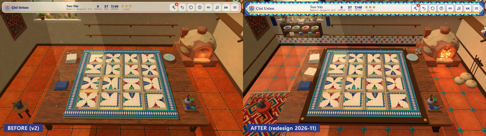

## Running locally

Serve the folder over HTTP (opened from `file://`, the browser blocks the asset files and the game uses its procedural models and textures):

```bash
python -m http.server 8000
```

Then open <http://localhost:8000/>.

## Made with Claude Code

Built by **Claude Fable 5.1** with Claude Code from one prompt: [prompts/cini-ustasi.md](prompts/cini-ustasi.md). The tile faces are painted at runtime on canvas from four edge motifs that must meet their twin exactly at the edge, the workshop was first built from procedural low-poly parts, and the music and sounds are synthesised with the Web Audio API. Three.js is loaded from jsDelivr under its MIT licence.

The assets were remastered by the orchestrator, **Claude Opus 5.5**, with generated models and textures: Tripo text-to-3D (through Higgsfield) for the kiln, the sitting cat and the paint set, and GPT Image for the table wood, the terracotta floor, the plaster, the window view, the kilim, the crest and a small panorama for the glaze reflections. They were processed with glTF-Transform and sharp (about 1.1 MB in `assets/`). The tile faces stay procedural on purpose, because generated art cannot guarantee that the motifs meet exactly at the edges, and every replaced part keeps its procedural version as the fallback. Prompts, sizes and remaining issues: [docs/assets.md](docs/assets.md). A Godot 4 remake was made in round 2.

### v2 update

Upgraded by **Claude Fable 5.1** with Claude Code from [prompts/cini-ustasi-v2.md](prompts/cini-ustasi-v2.md):

- **In-board coaching:** The how-to overlay was replaced with contextual in-board coaching on Level 1 and the first level of each chapter (`?` still opens the how-to card).
- **Kiln craft step:** Heat gauge with interactive timing; ratings (matte, glossy, master glaze) saved per panel and shown as a glaze sheen in the collection and on the workshop wall. Old saves load unchanged and receive a rating on their next firing.
- **Excavation daily boards:** Odd-day daily boards feature three weathered tiles that restore on their first matched edge, keeping the same solution, hints, and par.
- **Live star meter & feedback:** Progress bar under the top bar with star thresholds, pop animations, audio chimes, and a nudge when a move breaks a matched connection.
- **Master's gallery:** All 30 panels in the collection with detail views, glaze badges, and four unlockable craft notes detailing Iznik ceramic tradition.
- **Refined visuals & audio:** Lime-plaster grout, bright bevel rims, glossier tile glaze, sheen sweep on full tile match, preallocated glow geometry, system font stack, and bilingual messaging.

The in-game facts (kiln step, excavation intro, craft notes, title line) come from the research pool behind the brief; the source of each is noted in a code comment next to the `FACTS` table in `index.html`.

<details>
<summary><b>Technical notes</b></summary>

- **Puzzle core (`CORE BEGIN` to `CORE END`):** Pure JavaScript with zero DOM or Three.js dependencies, enabling headless unit testing under Node (`node tests/core.test.mjs`, 358/358 tests passing). Deterministic board generation guarantees every scrambled board is solvable.
- **Procedural tile painting:** Canvas-rendered Iznik motifs (tulip, carnation, saz leaf, rumi scroll) dynamically generated at runtime so edges align seamlessly across tiles.
- **Optimized rendering:** Preallocated geometry for matched-edge glow outlines, merged static scenery, instanced decorative elements, and low-poly assets totaling ~1.1 MB.
- **Audio synthesis:** Pure Web Audio API generating traditional Hicaz-scale oud plucks, background drone, chime flourishes, and firing ambience without external audio samples.

</details>

### Claude Game Arena

Çini Ustası is part of the **Claude Game Arena** series, where each game is built by a Claude model from one prompt.

[Hisar](https://furkiozknn.github.io/kale-savunmasi/) · [Çay Ocağı](https://furkiozknn.github.io/cay-ocagi/) · [Martı](https://furkiozknn.github.io/marti/) · [Kervan](https://furkiozknn.github.io/kervan/) · [Dolmuş](https://furkiozknn.github.io/dolmus/) · [Peri Golf](https://furkiozknn.github.io/peri-golf/) · [Mehter](https://furkiozknn.github.io/mehter/) · [Boğaz Vapuru](https://furkiozknn.github.io/bogaz-vapuru/) · [Simit Fırını](https://furkiozknn.github.io/simit-firini/) · [Karagöz](https://furkiozknn.github.io/karagoz/) · [Lale Bahçesi](https://furkiozknn.github.io/lale-bahcesi/)

**Round 5:** [Kapadokya Balonu](https://furkiozknn.github.io/kapadokya-balonu/) · [Ebru](https://furkiozknn.github.io/ebru/) · [Kırkpınar](https://furkiozknn.github.io/kirkpinar/) · [Çarşı Kaçışı](https://furkiozknn.github.io/carsi-kacisi/)

**Round 6:** [Topkapı Gecesi](https://furkiozknn.github.io/topkapi-gecesi/) · [Hamsi](https://furkiozknn.github.io/hamsi/) · [Pamukkale](https://furkiozknn.github.io/pamukkale/) · [Mimar Sinan](https://furkiozknn.github.io/mimar-sinan/)

## License

MIT, see [LICENSE](LICENSE).

Like the game? You can support new rounds on [Buy Me a Coffee](https://buymeacoffee.com/furkiozkann). The game stays free.
