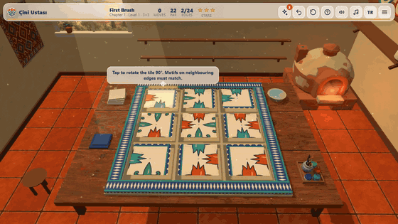
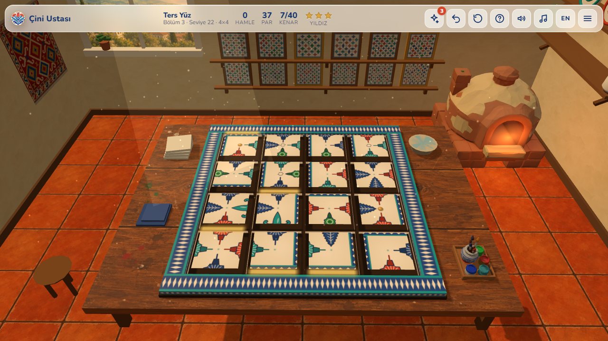
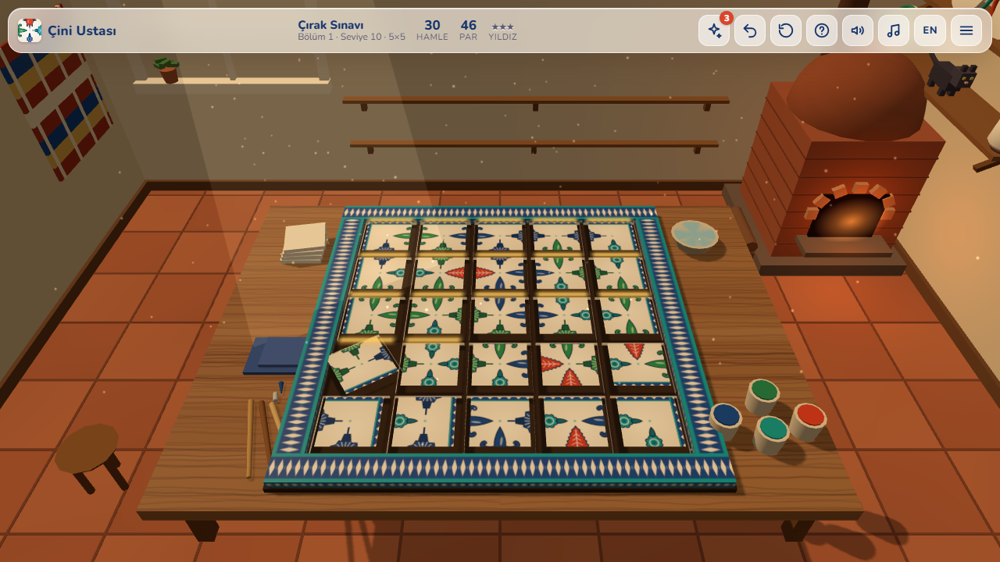
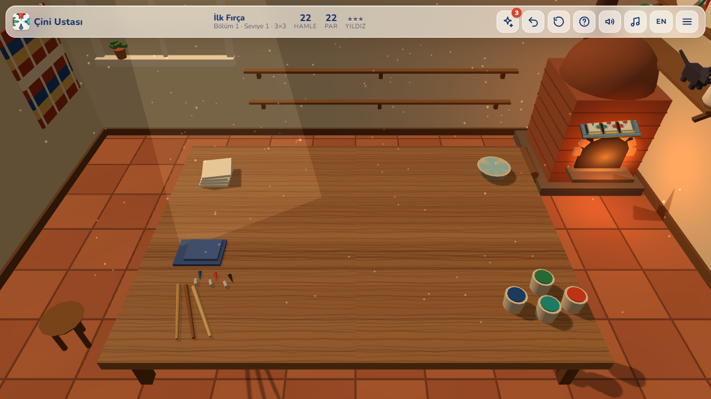
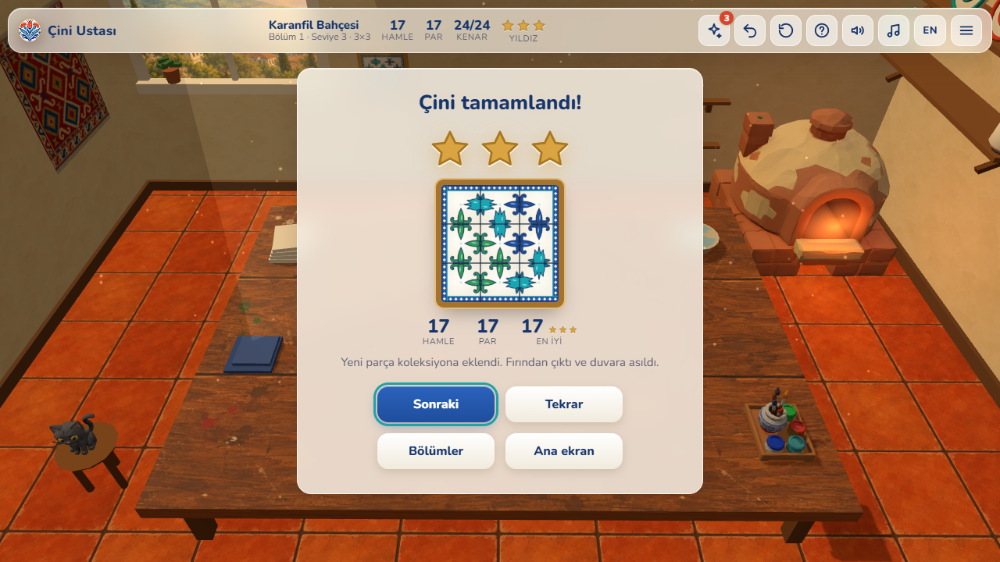
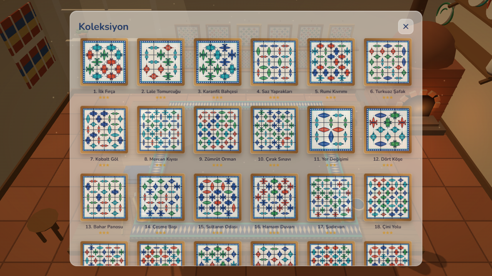
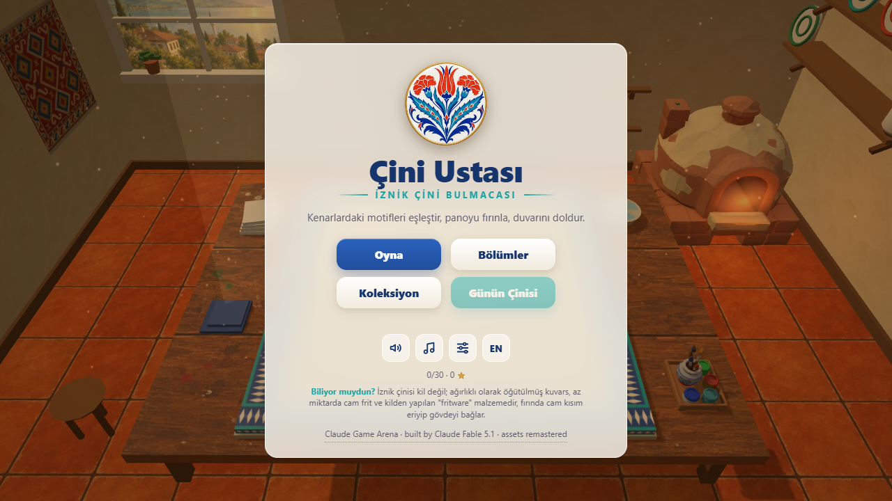
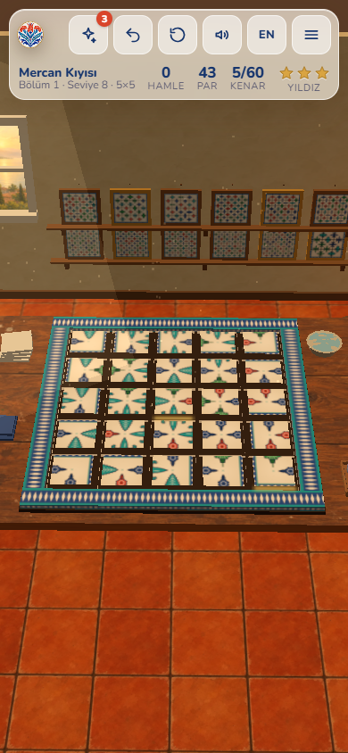

# 🎨 Çini Ustası · Iznik Tile Puzzle

**[▶ Play in your browser](https://furkiozknn.github.io/cini-ustasi/)** · Türkçe & English · desktop & mobile · free, no install

🏟️ Part of **[Claude Game Arena](https://github.com/Furkiozknn/claude-game-arena)**: four games, each built by a different Claude model. This is game #3, built by **Claude Fable 5.1**. [See all games and the scorecard →](https://furkiozknn.github.io/claude-game-arena/)

🎮 **Godot 4 remake (round 2):** [play](https://furkiozknn.github.io/cini-ustasi-godot/) · [code](https://github.com/Furkiozknn/cini-ustasi-godot), rebuilt by the same model in a real game engine.

A calm 3D edge-matching puzzle in a **single `index.html`** (Three.js, no build step, no image files).
In a warm tile workshop, rotate, swap and flip hand-painted Iznik tiles until every tulip, carnation,
saz leaf and rumi scroll connects across the board. Then watch the finished panel glaze, fire in the kiln
and take its place on your wall.

## Features

- **30 levels in 3 chapters**, each adding one mechanic: rotate tiles (chapter 1), swap tiles (chapter 2),
  then fixed tiles, double-sided tiles you can flip and 6×6 boards (chapter 3). Boards grow from 3×3 to 6×6.
- **Every level is guaranteed solvable:** boards are generated solved and then scrambled, and the built-in
  solver solves all 30 levels from the scrambled state.
- **Readable motifs:** five Iznik motifs in cobalt, turquoise, coral and emerald are drawn in code. Each motif is
  widest at the edge, so a matched pair forms one medallion, and matched edges glow gold.
- **Moves vs par and 1-3 stars**, undo, restart, three hints per level (each fixes one tile), and a
  **daily board** that unlocks after chapter 1.
- **The kiln sequence:** a solved board glazes with a shine sweep, slides into the glowing kiln, fires with
  sparks and comes out framed for your **collection wall** and gallery.
- **A living workshop:** dust motes in the window light, a flickering kiln, a cat that strolls along the shelf.
- **Generated music and sound:** oud-like plucks on a Hicaz scale over a soft drone, plus tile clicks, chimes
  and the kiln's whoosh, all made with Web Audio. Music and sound can be switched off separately.
- **Progress is saved** in your browser (stars, unlocked levels, collection).

| | |
|---|---|
|  |  |
|  |  |
|  |  |

## Controls

| Action | Mouse / keyboard | Touch |
|---|---|---|
| Rotate a tile 90° | Click | Tap |
| Swap two tiles (chapter 2+) | Drag one onto the other | Drag |
| Flip a double-sided tile (chapter 3) | Right-click | Long-press |
| Tilt the camera / zoom | Drag on the table / mouse wheel | Drag / pinch |
| Undo / hint / restart / menu | `Z` / `H` / `R` / `Esc` | Top bar |

## Run it locally

Download the repo and double-click `index.html` (it needs internet the first time, to load Three.js and the font from a CDN),
or serve the folder with `python -m http.server 8766` and open http://127.0.0.1:8766/.

### URL flags

| Flag | Effect |
|---|---|
| `?low` | No shadows, lower-resolution tile textures |
| `?lang=en` / `?lang=tr` | Interface language |
| `?level=N` / `?level=daily` | Jump to a level |
| `?auto` | The game solves itself with its real solver and moves on (self-test bot) |
| `?debug` | Draw calls, fps and any JS errors on screen; `window.ciniSim(seconds)` fast-forwards the game |
| `?sim=N` | Fast-forwards N seconds before the first frame |
| `?fresh` | Starts with empty progress |

## How it was made

Game #3 of a series in which **every game is built by a different AI model**, to compare which one makes the better game.
This one was built by **Claude Fable 5.1** (`claude-fable-5-1`) with [Claude Code](https://claude.com/claude-code), on its own,
from one prompt: [`prompts/cini-ustasi.md`](prompts/cini-ustasi.md). Every model gets the same prompt structure, quality bar and
self-test rule, and none of them sees the other games' code. The orchestrating session (Claude Opus 5.5) wrote the prompt,
re-tested the result independently and published it.

Verification before release: the solver solves all 30 levels and 5 daily boards; an independent bot run in a real browser
cleared all 30 levels with 90/90 stars and zero JS errors; about 25-55 draw calls depending on the board size. Review found one
visual bug (the board dipped into the table at the start of the kiln animation), which the builder fixed before release.

| # | Game | Genre | Model |
|---|---|---|---|
| 1 | [Hisar](https://github.com/Furkiozknn/kale-savunmasi) | Tower defense, 3D | Claude Opus 5.5 |
| 2 | [Çay Ocağı](https://github.com/Furkiozknn/cay-ocagi) | Time management, 3D | Claude Sonnet 5.5 |
| 3 | **Çini Ustası** | Puzzle, 3D | Claude Fable 5.1 |
| 4 | [Martı](https://github.com/Furkiozknn/marti) | Arcade flyer, 3D | Claude Haiku 5.5 |

## Tech

Three.js r170 (ES module from jsDelivr), canvas-generated tile textures, Web Audio API, one Google Font (Nunito).
About 1,900 lines of plain JavaScript, HTML and CSS in one file.

## License

Code: [MIT](LICENSE).
