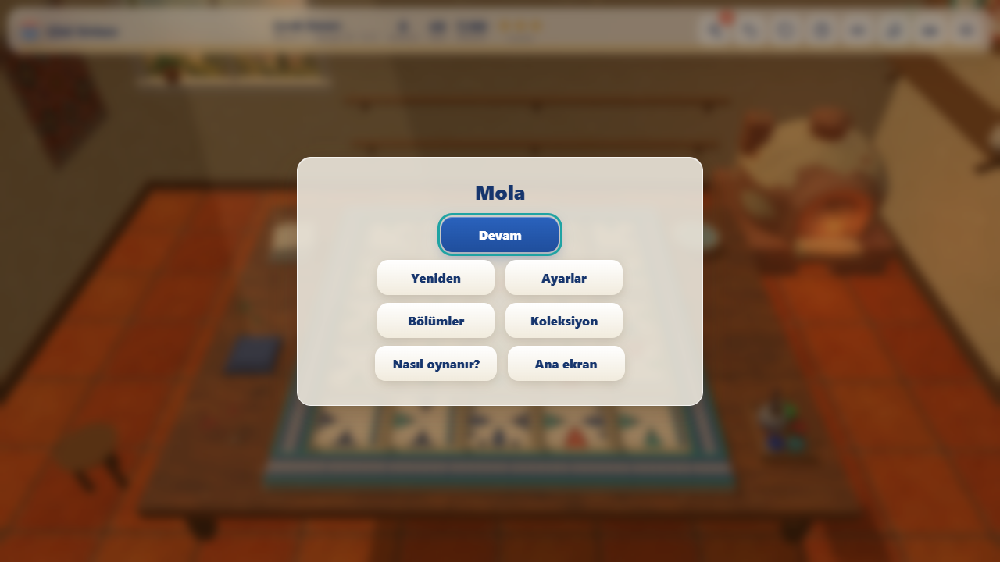
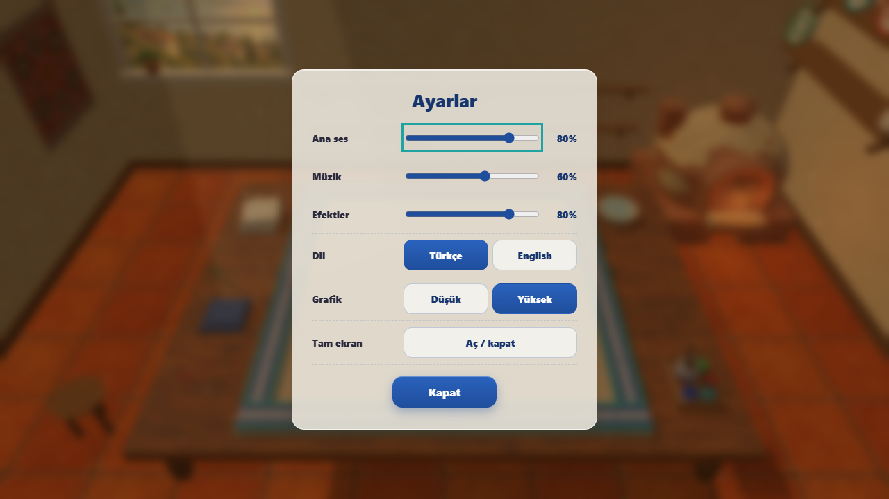
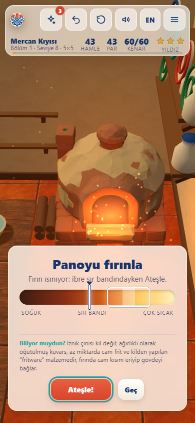

<p align="center">
  <a href="https://furkiozknn.github.io/cini-ustasi/"></a>
</p>

<p align="center">
  <a href="https://furkiozknn.github.io/cini-ustasi/"></a>
  
  
  <a href="LICENSE"></a>
  
</p>

<p align="center"><b>A calm 3D edge-matching puzzle in a warm tile workshop: rotate, swap and flip hand-painted Iznik tiles until every tulip, carnation, saz leaf and rumi scroll connects, then fire the finished panel in the kiln and hang it on your wall.</b></p>

<p align="center">
  
</p>

<p align="center"><b>Play online: <a href="https://furkiozknn.github.io/cini-ustasi/">https://furkiozknn.github.io/cini-ustasi/</a></b> (desktop and phone, no install)</p>

## Highlights

- **30 levels in 3 chapters.** Chapter 1 is about rotating tiles, chapter 2 adds swapping, chapter 3 adds fixed tiles
  and double-sided tiles you can flip; boards grow from 3x3 to 6x6.
- **Every level is solvable.** Boards are generated solved and then scrambled, and the built-in solver solves all 30
  levels and the daily boards from the scrambled state (checked by the tests).
- **Readable motifs.** Five Iznik motifs in cobalt, turquoise, coral and emerald are painted in code; each motif is
  widest at the edge, so a matched pair forms one medallion, and matched edges glow gold.
- **Moves against par.** 1 to 3 stars per level, undo, restart, three hints per level that each fix one tile, a
  matched-edge counter in the top bar and a **daily board** that unlocks after chapter 1.
- **The kiln sequence.** A solved board glazes with a shine sweep, slides into the glowing kiln, fires with sparks and
  comes out framed for your collection wall; the camera follows it, also on phones.
- **A living workshop.** Dust motes in the window light, a view of Lake Iznik, a flickering kiln, glossy glazed tiles
  and a cat that comes to sit on the stool; oud-like plucks on a Hicaz scale over a soft drone, made with Web Audio.

## How to play

> [!TIP]
> **Goal:** connect every edge on the board: each motif must meet its twin on the neighbouring tile. Solve the level in
> as few moves as possible to earn 3 stars, then watch the panel fire in the kiln.

Click a tile to rotate it by 90 degrees. From chapter 2 on, drag a tile onto another to swap them. In chapter 3 some
tiles are fixed in place, and double-sided tiles can be flipped with a right-click (or a long press). The top bar shows
your moves, the level's par and how many edges already match.

<details>
<summary><b>More rules</b></summary>

- Each level has a par, the length of the planned solution. Finishing at or under par gives 3 stars, within
  `ceil(1.6 x par) + 2` moves 2 stars, and any solve at least 1 star.
- Every level starts with three hints. A hint fixes one tile, planned against the board's own generated solution, so it
  is instant and never fails; undoing a hint gives it back.
- Fixed tiles stay at their home position and cannot be rotated, swapped or flipped.
- The daily board is a fresh 4x4 puzzle seeded by the date, with rotations and swaps; it unlocks after chapter 1.
- Solved panels join the collection and the gallery wall of the workshop; your best stars per level are kept.

</details>

### Controls

| Action | Mouse / touch | Keyboard |
|---|---|---|
| Rotate a tile 90 degrees | click / tap | |
| Swap two tiles (chapter 2 on) | drag one onto the other | |
| Flip a double-sided tile (chapter 3) | right-click / long press | `F` on the hovered tile |
| Tilt the camera / zoom | drag on the table / wheel or pinch | |
| Undo / hint / restart | top bar | `Z` / `H` / `R` |
| Pause menu | menu button | `P` / `Esc` |
| Music / effects / language | pause menu, settings | `M` / `X` / `L` |
| Buttons | tap | `Tab`, `Enter` / `Space` |

Settings (master, music and effects volume, TR / EN, Low / High graphics, fullscreen) are saved in `localStorage` under
`arena.cini.settings`; stars, unlocked levels and the collection under `arena.cini.save`, and the title offers
**Continue**. The first visit follows the browser language and picks Low graphics on touch devices or CPUs with 4
threads or fewer.

<details>
<summary><b>URL flags for testing</b></summary>

| Flag | Effect |
|---|---|
| `?auto` | the game solves each board itself (plans to the generated solution) and moves on |
| `?debug` | draw calls, fps and JS errors on screen; `window.ciniSim(seconds)` fast-forwards the game |
| `?sim=N` | fast-forward N seconds before the first frame |
| `?level=N` / `?level=daily` | jump to a level or the daily board |
| `?screen=levels` | open a screen: `levels`, `collection`, `howto` (`&ch=N` picks the page), `settings` or `pause` |
| `?low` | Low graphics for this visit (not saved) |
| `?noassets` | skip the asset files and use the procedural models and textures |
| `?lang=en` / `?lang=tr` | language |
| `?fresh` | start with empty progress and default settings |
| `?fill` | fill the collection for screenshots (saving disabled) |
| `?noanim` / `?nohowto` | skip CSS animations / skip the how-to card on a chapter's first level |

The live state is on `window.cini`.

</details>

## Screenshots

<table>
  <tr>
    <td width="33%"><br><sub>Title screen</sub></td>
    <td width="33%"><br><sub>Level 10, a 5x5 board mid-solve</sub></td>
    <td width="33%"><br><sub>Chapter 3: fixed and double-sided tiles</sub></td>
  </tr>
  <tr>
    <td><br><sub>The panel slides into the kiln</sub></td>
    <td><br><sub>Level complete, three stars</sub></td>
    <td><br><sub>The collection</sub></td>
  </tr>
</table>

<details>
<summary><b>Pause menu, settings and the phone layout</b></summary>

<table>
  <tr>
    <td width="50%"><br><sub>Pause menu</sub></td>
    <td width="50%"><br><sub>Settings</sub></td>
  </tr>
  <tr>
    <td><br><sub>Phone, level 8</sub></td>
    <td><br><sub>Phone, the camera follows the kiln</sub></td>
  </tr>
</table>

</details>

## Tests

The puzzle core (the block between `CORE BEGIN` and `CORE END` in `index.html`) has no DOM or Three.js dependencies and
is tested under Node, with no packages to install:

```
node tests/core.test.mjs
```

It checks all 30 levels and 5 daily boards: deterministic generation, a scrambled start, fixed tiles at home, the home
solution solves the board, par equals the planned solution's length and earns 3 stars, and the solver finds a solution.
Current result: `TESTS PASSED 345/345`. Before release, an independent bot run in a real browser also cleared all 30
levels with 90 of 90 stars and 0 JS errors.

## Running locally

Serve the folder over HTTP (opened from `file://`, the browser blocks the asset files and the game uses its procedural
models and textures):

```
python -m http.server 8000
```

then open <http://localhost:8000/>.

## How it was made

Built by **Claude Fable 5.1** with Claude Code from one prompt: [prompts/cini-ustasi.md](prompts/cini-ustasi.md). The
tile faces are painted at runtime on canvas from four edge motifs that must meet their twin exactly at the edge, the
workshop was first built from procedural low-poly parts, and the music and sounds are synthesised with the Web Audio API.

The assets were remastered by the orchestrator, **Claude Opus 5.5**, with generated models and textures: Tripo
text-to-3D (through Higgsfield) for the kiln, the sitting cat and the paint set, and GPT Image for the table wood, the
terracotta floor, the plaster, the window view, the kilim, the crest and a small panorama for the glaze reflections.
They were processed with glTF-Transform and sharp (about 1.1 MB in `assets/`). The tile faces stay procedural on purpose,
because generated art cannot guarantee that the motifs meet exactly at the edges, and every replaced part keeps its
procedural version as the fallback. Prompts, sizes and remaining issues: [docs/assets.md](docs/assets.md). A Godot 4
remake was made in round 2.

Çini Ustası is part of the **Claude Game Arena** series, where each game is built by a Claude model from one prompt.
The other games: [Hisar](https://furkiozknn.github.io/kale-savunmasi/) ·
[Çay Ocağı](https://furkiozknn.github.io/cay-ocagi/) · [Martı](https://furkiozknn.github.io/marti/) ·
[Kervan](https://furkiozknn.github.io/kervan/) ·
[Dolmuş](https://furkiozknn.github.io/dolmus/) · [Peri Golf](https://furkiozknn.github.io/peri-golf/) ·
[Mehter](https://furkiozknn.github.io/mehter/) · [Boğaz Vapuru](https://furkiozknn.github.io/bogaz-vapuru/) ·
[Simit Fırını](https://furkiozknn.github.io/simit-firini/) · [Karagöz](https://furkiozknn.github.io/karagoz/) ·
[Lale Bahçesi](https://furkiozknn.github.io/lale-bahcesi/)

**Round 5:** [Kapadokya Balonu](https://furkiozknn.github.io/kapadokya-balonu/) ·
[Ebru](https://furkiozknn.github.io/ebru/) · [Kırkpınar](https://furkiozknn.github.io/kirkpinar/) ·
[Çarşı Kaçışı](https://furkiozknn.github.io/carsi-kacisi/)

## Türkçe

**Çini Ustası**, sıcak bir çini atölyesinde geçen sakin bir 3D kenar eşleştirme bulmacası. El boyaması İznik çinilerini
çevir, yer değiştir ve ters yüz et; her lale, karanfil, saz yaprağı ve rumi kıvrımı komşusuyla birleşsin. Biten panoyu
fırında pişir ve atölyenin duvarına as. Üç bölümde 30 seviye ve her gün yeni bir pano var. Kurulum yok; masaüstünde ve
telefonda tarayıcıda oynanır. Claude Fable 5.1 tarafından Claude Code ile tek bir prompt'tan yapıldı.

**Oyna:** https://furkiozknn.github.io/cini-ustasi/

## License

MIT, see [LICENSE](LICENSE).
